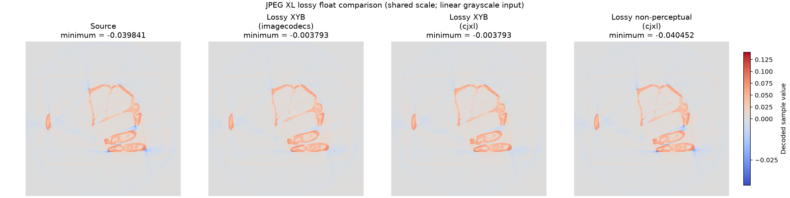
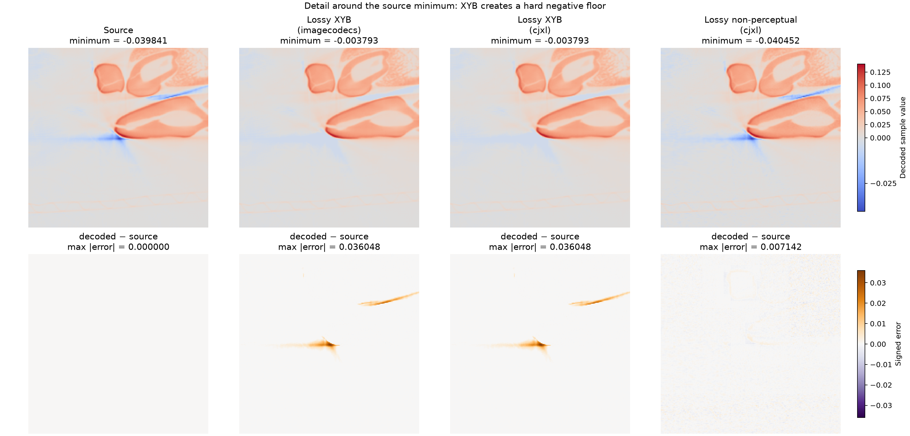

# JPEG XL negative-float reproduction

See: https://github.com/cgohlke/imagecodecs/issues/149

Run from the repository root:

```console
pixi run python jxl_negativity_repro/reproduce.py
```

The script compares the supplied input and JXL with `cjxl`, direct imagecodecs,
tifffile JPEG XL, normalized tifffile JPEG XL, and controlled lossy XYB and
non-perceptual `cjxl` round trips. It runs `cjxl --version` dynamically and
prints the returned version; the version string is not hard-coded.

With tifffile 2026.7.14, imagecodecs 2026.6.26, and libjxl/cjxl 0.12.0:

```text
case                              minimum      maximum  < -0.004   mean error    max error
source input.pfm               -0.03984109   0.13882673      7148   0.00000000   0.00000000
supplied output.jxl             -0.03963732   0.13820329      7118   0.00007106   0.00082651
cjxl binary                     -0.03998225   0.13892519      7023   0.00028588   0.00301334
cjxl lossy XYB                  -0.00379309   0.13863659         0   0.00006751   0.03604802
cjxl non-perceptual             -0.04045153   0.14020272      8615   0.00055427   0.00714181
direct imagecodecs              -0.00379309   0.13863659         0   0.00006751   0.03604802
tifffile JPEG XL                -0.00379308   0.13888425         0   0.00006705   0.03604802
tifffile after [0, 1]           -0.03983187   0.13915542      7166   0.00005122   0.00069638
```

Ordinary lossy linear-light encoding clips the deep negative tail rather than
removing every negative sample. The minimum changes from about `-0.03984` to
`-0.00379`, losing every source pixel below `-0.004`.

Lossy encoding itself is not the limitation. Both controlled `cjxl` cases use
the same explicit linear grayscale interpretation. The ordinary case enters
XYB and matches direct imagecodecs exactly; adding
`--disable_perceptual_optimizations` bypasses XYB and retains the negative tail
while remaining lossy at `distance=0.01`. The current imagecodecs Python API
does not expose the two libjxl controls required to select that path, so
tifffile cannot request it through `compressionargs`.

## Diagnostic figures



All four panels use one diverging colorbar centered at zero. The imagecodecs
and `cjxl` XYB results have the same visibly truncated minimum, while the
non-perceptual `cjxl` result spans the source's negative range.



The upper row shares the decoded-value colorbar. The lower row shows signed
error on a second shared colorbar, making the irreversible positive error from
the XYB negative clamp visible.

The direct imagecodecs result shows that tifffile's TIFF container code is not
the layer introducing the behavior: tifffile dispatches JPEG XL compression to
`imagecodecs.jpegxl_encode`, and that direct call reproduces it. Imagecodecs
documents float encoder input as requiring the nominal range `[0, 1]`, while
libjxl's encoder API permits finite values outside that range.

For exact data, `compressionargs={"lossless": True}` preserves the float32
samples bit-for-bit. For lossy scientific data, normalization remains an
available workaround until imagecodecs exposes libjxl's original-profile,
non-perceptual mode; JPEG XL distance is not a numerical error bound.
